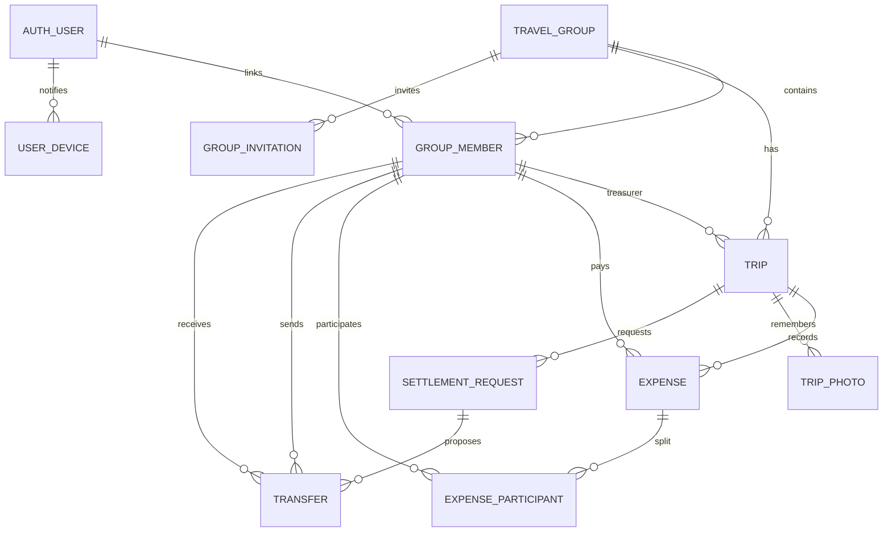

# 계정·모임 멤버·초대·접근 권한 설계

## 문서 상태

- **상태:** Supabase와 이메일 확인·Google·Kakao 로그인이 승인되었고, 계정 프로필 닉네임 등록/변경, 고유 친구 ID, 친구 요청과 목록 화면을 구현했다. 새 로그인 계정은 닉네임을 정해야 앱 기록에 진입할 수 있다. 별도 마이그레이션 `202610120001_profiles_and_friends.sql`을 Supabase에 적용해야 서버 중복 검사와 친구 저장 기능이 활성화된다. 기기 로컬 기록은 로그인 계정 ID별로 분리하며, 처음 로그인한 계정은 빈 기록으로 시작한다. 친구 연결은 여행 데이터 접근 권한을 주지 않는다. 원격 모임 동기화, 친구를 모임에 초대하는 기능, 명시적 로컬 이전은 아직 구현하지 않았다. Naver는 현재 범위에서 제외한다.
- **목표:** 현재 한 기기에 저장되는 앱을 여러 친구가 안전하게 함께 쓰기 위해 계정과 모임 멤버의 연결, 초대, 데이터 권한, 기존 기록 이전의 기준을 정리한다.
- **선택:** Supabase. 관계형 모임·여행·지출 데이터, 인증, Row Level Security를 한 흐름으로 구성한다. 실제 프로젝트 연결은 [`SUPABASE_SETUP.md`](SUPABASE_SETUP.md)를 따른다.

## 현재 상태와 제약

- 앱은 그룹·멤버 이름·여행·지출을 로그인한 Supabase 사용자 ID별 기기 SQLite 저장 키에만 저장한다. 새 계정은 빈 목록으로 시작한다. 계정 전 기록은 기존 키에 보존되며, 가져오기 UI가 없어서 현재 계정에서는 보이지 않는다. 다른 휴대폰으로 동기화하거나 친구에게 알림을 보낼 수 없다.
- 현재 `Member`는 이름과 로컬 ID만 가진다. 이름만으로 로그인 계정을 연결하면 동명이인 또는 잘못된 연결이 생길 수 있다. 모임 생성 시 로그인 사용자 닉네임을 첫 항목으로 만들지만, 해당 항목은 아직 서버 계정과 연결되지 않는다.
- 정산 요청은 총무가 만들고, 송금할 멤버가 자신의 송금 완료를 표시하며, 필요한 확인이 모두 모이면 여행을 자동 완료하는 동작으로 승인되어 있다. 은행 이체 자체는 앱이 확인하지 않는다.
- 사진 파일은 앱 내부 저장소에 있고 GPS 좌표가 있을 수 있다. 서버로 올릴 때는 모임 멤버 권한과 위치 정보 접근 범위를 함께 보호해야 한다.

## 목표 구조

사용자는 인증 계정으로 앱에 로그인하고, 계정은 모임 안의 멤버 항목과 명시적으로 연결된다. 모임 데이터의 서버 접근은 현재 활성 멤버십을 기준으로 허용한다. 로컬 모임은 로그인 뒤 서버 모임으로 이전할 수 있으며, 친구는 초대를 수락한 계정으로 연결한다.

## 데이터 개체 초안

| 개체 | 핵심 필드 | 용도 |
| --- | --- | --- |
| `profiles` | `user_id`, `display_name`, `nickname`, `friend_code`, `notifications_enabled`, `created_at` | 인증 시스템의 불변 사용자 ID에 앱 프로필을 연결한다. 닉네임과 친구 ID는 서로 다른 사용자 식별 표현이고, 이메일은 로그인·연락 정보이며 멤버 식별 키로 쓰지 않는다. |
| `groups` | `id`, `name`, `owner_user_id`, `created_at` | 인증 계정 소유자 ID를 저장한다. 소유자는 활성 `group_members` 한 행과 반드시 일치해야 한다. |
| `group_members` | `id`, `group_id`, `user_id?`, `display_name`, `role`, `status` | 기존 멤버 행을 보존하고, 초대를 수락한 경우에만 `user_id`를 연결한다. 초대 전에는 `user_id`가 비어 있을 수 있다. 같은 모임에서 하나의 계정은 한 멤버 행에만 연결한다. |
| `group_invitations` | `id`, `group_id`, `group_member_id`, `created_by`, `token_hash`, `expires_at`, `consumed_at?`, `accepted_by?`, `revoked_at?` | 한 초대는 정확히 한 대기 멤버 행을 가리킨다. 원문 초대 토큰 대신 해시를 저장하고, 수락·만료·취소 여부를 관리한다. |
| `trips` | `id`, `group_id`, `name`, `treasurer_member_id`, dates, lifecycle fields | 모임에 속한 여행과 총무를 저장한다. |
| `expenses` | `id`, `trip_id`, `title`, `amount`, `payer_member_id`, `created_by_user_id`, `updated_at` | 결제 내역을 저장한다. `created_by_user_id`는 수정 권한과 변경 이력을 판정하는 데 쓴다. |
| `expense_participants` | `expense_id`, `group_member_id` | 지출별 분담자를 연결한다. 분할 나머지는 현재 승인된 멤버 순서 규칙으로 계산한다. |
| `trip_photos` | `id`, `trip_id`, `storage_path`, GPS fields?, `added_by_user_id`, `created_at` | 사진 메타데이터와 비공개 저장 경로를 관리한다. 사진 위치는 권한 있는 여행 멤버만 읽을 수 있게 한다. |
| `settlement_requests` | `id`, `trip_id`, `created_by_user_id`, `status`, `input_version`, `requested_at`, `completed_at?` | 총무가 정산 요청을 보낸 시점의 지출 버전과 완료 상태를 저장한다. 하위 `transfers` 행으로 요청 시점의 송금 계산 결과를 고정한다. |
| `transfers` | `id`, `request_id`, `from_member_id`, `to_member_id`, `amount`, `confirmed_at?` | 요청에 포함된 각 송금과 보낸 멤버의 완료 확인을 저장한다. |
| `user_devices` | `id`, `user_id`, `push_token`, `platform`, `last_seen_at`, `disabled_at?` | 계정별 여러 휴대폰의 푸시 주소를 저장한다. 토큰은 본인과 서버만 다룬다. |
| `friend_requests` | `id`, `requester_user_id`, `addressee_user_id`, `status`, timestamps | 친구 요청, 수락/거절, 친구 목록 관계를 관리한다. 이메일은 서로 공개하지 않는다. |

기존 로컬 ID는 서버 ID와 일대일 대응을 기록해 재시도 때 중복 생성되지 않도록 한다. 실제 데이터베이스에서 UUID 또는 현재 문자열 ID 중 무엇을 쓸지는 선택한 백엔드의 제약을 확인한 뒤 확정한다.

## 접근 권한 초안

| 작업 | 허용 대상 | 서버 검사 기준 |
| --- | --- | --- |
| 모임·여행·지출·정산·사진 읽기 | 활성 모임 멤버 | 요청한 계정이 해당 모임의 활성 `group_members`인지 확인 |
| 초대 생성·취소, 멤버 역할 변경 | 모임 소유자/관리자 | 해당 모임의 관리자 멤버십 확인 |
| 여행 생성·수정·여행 상태 변경 | 모임 멤버; 정산 요청/재개는 여행 총무 | 여행의 `group_id`와 권한 있는 멤버십 확인 |
| 지출 생성 | 모임 멤버 | 해당 여행의 모임에 활성 멤버로 연결되었는지 확인 |
| 지출 수정·삭제 | 작성자 또는 여행 총무/모임 관리자 | 멤버십과 지출 작성자/역할 확인. 정산 완료 상태에서는 먼저 총무가 정산을 다시 열어야 한다. |
| 송금 완료 표시 | 해당 송금의 보내는 멤버 계정 | 로그인 계정이 `from_member_id`에 연결된 계정인지 확인 |
| 푸시 토큰 등록·해제 | 해당 기기의 로그인 사용자 | 토큰 레코드의 `user_id`가 인증 계정과 일치하는지 확인 |

클라이언트에서 버튼을 숨기는 것만으로 권한을 보장하지 않는다. 데이터베이스 정책과 서버 함수에서 매 요청의 사용자·모임·역할을 검사한다. 앱에 공개 가능한 키 외의 서비스 키나 푸시 발송 비밀은 앱 번들에 넣지 않는다.

## 초대 및 계정 연결 흐름

1. 모임 소유자가 특정 대기 멤버 행을 만들거나 고른 뒤, 그 행에 묶인 초대를 만든다.
2. 앱은 추측하기 어려운 일회용 초대 링크/코드를 만들고 서버에는 해시와 만료·취소 정보를 둔다.
3. 초대받은 친구는 로그인/가입 후 초대 내용을 확인하고 직접 수락한다.
4. 서버는 수락 계정을 초대에 지정된 바로 그 멤버 ID에 연결한다. 이름이나 이메일이 같다는 이유만으로 자동 연결하지 않는다.
5. 수락된 멤버에게만 해당 모임의 데이터와 사진·위치·정산을 보여준다.

초대 링크/코드의 사용 기한, 이메일/문자 초대 지원 여부, 한 계정을 여러 모임에 연결하는 세부 동작은 제품 선택으로 남긴다. 초대 링크를 받은 사람을 화면에서 확인하고 수락시키는 단계는 실수 초대를 줄이기 위한 권장안이다.

초대는 반드시 한 `group_member_id`에 묶는다. 수락 시 서버 트랜잭션에서 토큰이 유효하고 미사용인지, 대상 멤버가 아직 대기 상태인지, 계정이 이미 다른 멤버 행으로 연결되지 않았는지 확인한 뒤 `user_id`와 `consumed_at`을 한 번에 기록한다. 같은 초대를 동시에 수락하거나 재사용할 수 없도록 행 잠금/조건부 갱신과 `(group_id, user_id)` 고유 제약을 함께 사용한다. 계정 이름이나 이메일이 멤버 이름과 같아도 자동 연결하지 않는다.

사용자는 고유 친구 ID로 다른 계정을 찾아 친구 요청을 보낼 수 있고, 상대방이 수락하면 친구 목록에 표시한다. 친구 ID 검색은 이메일을 노출하지 않는다. 모임 초대는 친구 목록에서 대상을 골라 보내거나, 대상 멤버 행에 묶인 일회용 초대 코드를 메시지 앱으로 공유할 수 있다. 초대 코드를 입력한 계정이 로그인/가입 후 수락하면 그 pending 멤버 행에 연결한다. 기존 비회원 멤버 추가도 유지한다.

### 소유자와 역할 불변 규칙

- 각 모임에는 활성 소유자가 정확히 한 명 있어야 한다. `groups.owner_user_id`는 그 모임의 활성 `group_members.user_id`와 일치해야 하고, 해당 멤버 행의 `role`은 `owner`여야 한다.
- 모임 생성 또는 이전 시 소유자 계정과 멤버 행을 같은 서버 트랜잭션에서 만든다. 기존 로컬 기록은 이름만 보고 로그인 사용자에게 연결하지 않는다. 새 로컬 모임에서는 현재 계정 닉네임으로 만든 첫 멤버를 소유자 후보로 삼는다.
- 소유자는 모임 관리자 권한을 다른 활성 계정으로 넘기는 트랜잭션을 수행할 수 있다. `groups.owner_user_id`와 두 멤버의 역할은 함께 바뀐다.
- 소유자는 소유권을 넘기거나 모임을 삭제하기 전까지 자신을 비활성화하거나 모임에서 나갈 수 없다. 관리자는 다른 멤버를 관리할 수 있지만 소유자 역할을 부여하거나 소유자를 강등할 수 없다.
- 클라이언트의 `role` 값은 신뢰하지 않는다. 데이터베이스 트리거/정책 또는 서버 함수가 소유자 일치, 단일 소유자, 자기 승격 금지를 검사한다.

### 정산 요청 중 변경 안전 규칙 — 권장안

정산 요청은 생성 시점의 송금표를 고정하지만, 해당 입력이 바뀌면 확인 상태를 그대로 쓸 수 없다. 권장 흐름은 다음과 같다.

1. 요청을 만들 때 여행의 현재 지출 입력 버전(`input_version`)과 송금표를 저장한다.
2. 요청 대기 중 지출 추가/삭제, 지출 금액·결제자·분담자 변경, 또는 여행 정산 대상 멤버 변경이 일어나면 한 서버 트랜잭션에서 여행의 `input_version`을 올리고 요청을 `invalidated`로 바꾸며 기존 송금 확인을 완료 판단에 사용하지 않는다. 지출 제목만 바뀌는 경우는 계산 입력이 아니므로 무효화하지 않는다.
3. 정산 결과를 현재 데이터로 다시 계산한다. 총무가 새 정산 요청을 보내면 새 버전의 송금표와 새 확인 상태를 만든다.
4. 마지막 송금 완료 처리 시 서버가 요청 상태, 입력 버전 일치, 모든 필요한 송금 확인을 한 트랜잭션에서 검사한다. 하나라도 다르면 여행을 완료 처리하지 않는다.

이 동작은 잘못된 금액으로 송금 완료되는 것을 막는 권장 서버 규칙이며, 화면 문구와 정산 진행 중 수정 안내는 구현 전에 확정한다.

## 현재 휴대폰 데이터 이전

1. 로그인 전 기존 로컬 SQLite 스냅샷을 별도 보존하고 읽기 전용 미리보기를 제공한다. 새 계정은 자동으로 이 기록을 가져오지 않는다.
2. 처음 로그인한 계정을 이전 모임의 소유자로 연결한다. 기존 멤버 목록에서 본인을 지정하거나 새 본인 항목을 추가하도록 안내하며, 이름이 비슷한 행을 자동 선택하지 않는다.
3. 그룹·여행·지출의 관계와 완료 상태를 서버에 먼저 저장하고, 로컬 ID와 서버 ID의 대응을 기록한다.
4. 기존 멤버 이름은 유지하되 각 멤버의 계정은 초대를 수락하기 전까지 연결하지 않는다.
5. 사진은 서버 이전과 위치 업로드 범위를 확인할 때까지 로컬 원본을 보존한다. 업로드 실패 시 로컬 데이터를 지우지 않고 재시도한다.
6. 동일한 이전 요청을 재실행해도 중복 여행·지출이 생기지 않게 한다.

로컬 기록은 서버 저장과 검증이 완료될 때까지 삭제하지 않는다. 여러 기기에 이미 서로 다른 로컬 기록이 있을 때 자동 병합할지, 사용자에게 충돌을 선택하게 할지는 다음 단계에서 확정한다.

## 구현 순서 제안

1. **완료:** Supabase 계정 인증과 기본 스키마/RLS 마이그레이션을 준비했다. 프로젝트 키와 외부 제공자 키를 설정해야 실제 인증 왕복을 시험할 수 있다.
2. 초대 UI와 모임 멤버 연결을 구현하고, 일회용 초대 RPC를 통합한다.
3. 기존 기기 데이터의 미리보기·백업·안전한 이전을 구현한다.
4. 원격 모임·여행·지출 동기화와 사진 업로드를 구현한다.
5. 푸시 권한, 기기 토큰 등록/해제, 서버 발송을 구현한다.
6. 정산 생성·송금별 확인·모든 확인 후 여행 완료를 서버 RPC로 원자적으로 연결한다.

## 열린 선택

- **백엔드 제공자:** Supabase 선택. 프로젝트 리전, 백업, 운영 비용 설정은 배포 전 확인한다.
- **로그인 필수 범위:** 로그인 전에는 앱 페이지를 보여주지 않는다. 현재 로컬 기록은 기기에 보존되지만, 계정 귀속/원격 동기화는 데이터 이전 기능이 완성될 때까지 완료된 것으로 간주하지 않는다.
- **계정 방법:** 이메일 확인, Google, Kakao를 지원한다. Naver 로그인은 추가 요청 전까지 구현하지 않는다. SMTP 발송 설정은 배포 전 확인한다.
- **초대 방식과 유효 기간:** 링크/코드, 이메일/전화번호 직접 초대 중 선택한다.
- **역할과 수정 권한:** 그룹 소유자, 모임 멤버, 여행 총무의 관리 범위를 확정한다. 위 표는 보안 기본안이다.
- **정산 요청 후 수정:** 지출 변경 시 요청을 무효화하고 다시 요청하게 할지, 진행 중 수정을 잠글지 최종 흐름을 선택한다. 위에는 무효화 후 재요청을 권장안으로 기록했다.
- **사진과 위치:** 서버 저장 지역, 보존/삭제 정책, 사진 GPS 공개 동의와 탈퇴 시 삭제 범위를 결정한다.
- **오프라인/충돌:** 공유 모임의 오프라인 수정, 서버 재연결, 동시에 수정한 경우의 처리 방법을 결정한다.
- **운영:** 프로젝트 지역, 백업, SMTP, 푸시 설정, 예상 비용과 사용자 증가 시 한도를 확인한다.

## 참고

- [Supabase Auth](https://supabase.com/docs/guides/auth) — 이메일·소셜 로그인, 사용자 ID와 인증
- [Supabase Row Level Security](https://supabase.com/docs/guides/database/postgres/row-level-security) — 데이터베이스 행 단위 접근 정책
- [Expo Push Notifications](https://docs.expo.dev/push-notifications/sending-notifications/) — 서버에서 Expo 푸시 서비스로 알림 보내기
