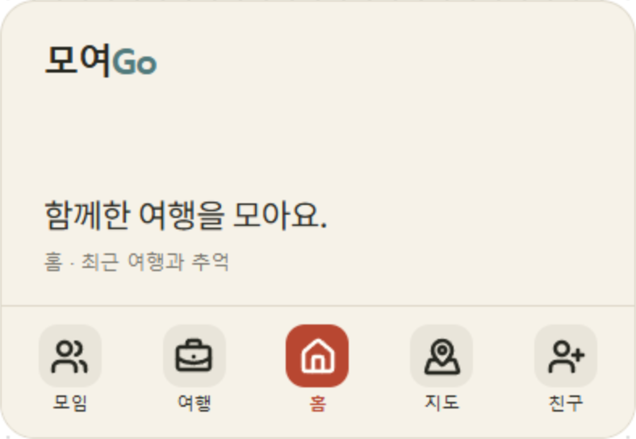
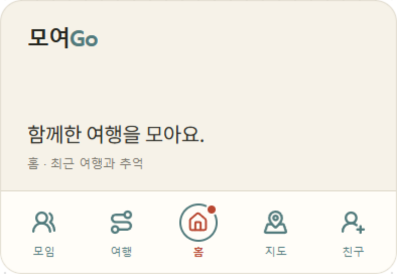
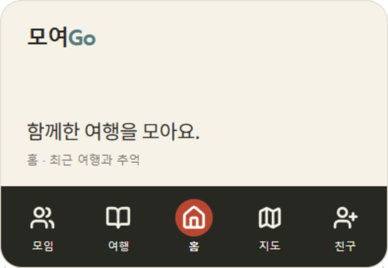

# 하단 메뉴 아이콘 보관 시안

2026-10-13에 사용자가 2·3·4번 시안을 보관해 달라고 했다. 4번을 적용해 본 뒤 3번으로 바꾸기로 했다. 세 시안 모두 탭 순서는 `모임 · 여행 · 홈 · 지도 · 친구`다. 아래 이미지는 홈 탭이 선택된 상태다.

## 2번 · 컬러 배지

각 아이콘을 연한 종이색 배지에 넣고 선택된 탭만 녹슨 주황색으로 채운다. 후보로 보관하며 현재 앱에는 적용하지 않는다.

## 3번 · 여행 경로 (현재 선택)

로고의 청록색 경로 느낌을 아이콘에 옮기고, 선택된 탭에 원형 경로와 주황색 도착점을 둔다. 현재 앱의 기준 시안이다.

## 4번 · 잉크 바

짙은 잉크색 바에 밝은 아이콘과 이름을 두고, 선택된 탭만 녹슨 주황색 원으로 강조한다. 여행은 기록을 뜻하는 열린 책 아이콘을 사용한다. 한 번 적용해 보았으나 현재는 후보로 보관한다.

이 시안의 아이콘은 Lucide 원본을 바탕으로 만든 앱 내 이미지 자산이며, 라이선스는 [`assets/navigation/LUCIDE_LICENSE.txt`](../assets/navigation/LUCIDE_LICENSE.txt)에 보관한다. 다른 시안을 선택하면 이 문서의 이미지를 참고해 `App.tsx`의 하단 메뉴를 변경한다.
